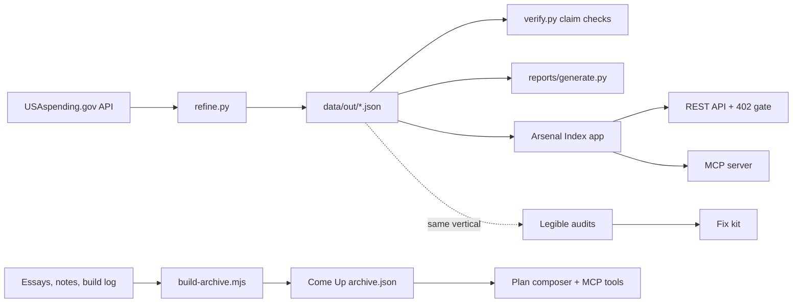

# Agent Web Products

Three small products built for AI agents as paying customers: a defense-contracting data feed with an MCP server, an agent-readiness audit engine, and an expert archive turned into a single-job planning tool.

> The human web monetized attention. The agent web can charge for useful resources.

Cloudflare's Pay Per Crawl, Monetization Gateway and x402 (HTTP 402 Payment Required) let a resource charge the agent that requests it, with no checkout or account. Every product here had to answer one question: **what does an agent need badly enough, often enough and reliably enough to pay for?**

## The three products

| | Product | What it does | Port |
|---|---|---|---|
| 1 | **Arsenal Index** | Turns public USAspending.gov award data for Huntsville, AL defense contracting into a firm directory, a recompete radar, a REST API and an MCP server | 4801 |
| 2 | **Legible** | Audits a company website for how well AI agents can understand, trust and recommend it, then generates a fix kit | 4802 |
| 3 | **Come Up** | One tagged expert archive plus one workflow: paste your skill and situation, get an offer, a price, a first channel and a 30-day plan, with citations | 4803 |

All three share one design system (`brand/tokens.css`) and differ by a single `--accent` token.

## Features

**Arsenal Index**
- Python refinery (`data/ingest/refine.py`) pulls ~6,000 prime awards from the key-free USAspending API and writes denormalized JSON.
- A refinery run produced 426 Huntsville-headquartered firms and 1,463 contracts expiring within 24 months (snapshot dated 2026-08-16, in `data/out/meta.json`).
- Recompete Radar: every expiring contract with incumbent, value, sub-agency, NAICS and expiry date.
- Markdown report generator (`data/reports/generate.py`) for sellable artifacts: recompete radar, small-business prospects, agency map, capability gap.
- `data/verify.py` re-checks every figure quoted in `docs/` against the dataset and exits non-zero if a claim no longer holds.
- Next.js app with a public REST API (`/api/v1/firms`, `/recompetes`, `/agencies`, `/naics`, `/market`, `/export`), an MCP server over HTTP and stdio, `llms.txt`, and an HTTP 402 gate on paid tiers.
- Two payment rails: `X-API-Key` on a Stripe subscription, and x402 per-lookup settlement (off by default; unverified payment proofs are rejected).

**Legible**
- Crawler and scorer that rate a site on seven agent-readiness dimensions (discoverable, parseable, priced, comparable, proven, current, and "fog" for vague copy), plus GovCon checks such as NAICS, CAGE and certifications.
- Optional buyer-intent prompt battery run against a live model to show what AI currently says about the company; prints a dry run without a key.
- Fix-kit generators that output the missing structured data and copy.
- CLI: `node scripts/audit.mjs <domain> --out report.json`. Two sample reports of public company sites are in `apps/legible/samples/`.

**Come Up**
- Archive extractor normalizes essays, notes and a distilled build log into `src/data/archive.json`, with a regex redaction pass for emails, home paths and key-shaped tokens.
- Items are tagged across six axes (job, topic, audience, example, framework, outcome); retrieval filters on tags before it looks at text.
- Plan composer: grounded by Claude when `ANTHROPIC_API_KEY` is set, otherwise a deterministic composer labelled "template".
- JSON API and MCP tools for archive search and plan generation.

## How it works



Legible targets the same vertical as Arsenal Index on purpose: an agent asked to "find an SDVOSB near Redstone with CMMC Level 2" cannot recommend a firm whose website never states any of that.

## Tech stack

- Next.js 15, React 19, TypeScript, Tailwind CSS (three separate apps)
- Python 3 standard library for the refinery, reports and verification
- Model Context Protocol servers in plain Node (`mcp/server.mjs`)
- Stripe Checkout via REST (test mode), x402 payment rules
- Anthropic API (optional) for the prompt battery and plan composer

## Getting started

```bash
# 1. Rebuild the dataset (no API key needed)
python3 data/ingest/refine.py --pages 60
python3 data/verify.py
python3 data/reports/generate.py

# 2. Run an app
cd apps/arsenal-index && cp .env.example .env.local && npm install && npm run dev   # :4801
cd apps/legible       && cp .env.example .env.local && npm install && npm run dev   # :4802
cd apps/comeup        && cp .env.example .env.local && npm install && npm run dev   # :4803

# 3. Audit a site from the terminal (Node 22.18+ strips TS types on import)
cd apps/legible && node scripts/audit.mjs example.com --out samples/example.json

# 4. Offline tests for the operations report
python3 -m unittest discover -s data -p 'test_operations_report.py'
```

Every environment variable is optional; each app documents its own in `.env.example`:

| Variable | Used by | Effect when empty |
|---|---|---|
| `STRIPE_SECRET_KEY` | all three | Pricing buttons fall back to a request form or waitlist |
| `STRIPE_PRICE_RADAR`, `STRIPE_PRICE_INTELLIGENCE`, `STRIPE_PRICE_AGENT_API` | Arsenal Index | Checkout disabled for that tier |
| `ARSENAL_API_KEYS` | Arsenal Index | No key skips the 402 gate |
| `X402_ENABLED` | Arsenal Index | x402 proofs are rejected |
| `ANTHROPIC_API_KEY` | Legible, Come Up | Battery runs dry; plans use the deterministic composer |
| `NEXT_PUBLIC_SITE_URL` | all three | Defaults to localhost |

## Project structure

```
brand/tokens.css        shared design tokens (one --accent per product)
data/ingest/refine.py   USAspending -> structured JSON refinery
data/out/               generated dataset; index.json is the canonical file
data/reports/           report generator and sample markdown output
data/verify.py          checks every published figure against the data
data/CAVEATS.md         known data-quality limits
apps/arsenal-index/     data product: web app, REST API, MCP server
apps/legible/           audit engine, CLI, fix kit, sample reports
apps/comeup/            archive extractor, tagger, plan composer, MCP server
docs/                   thesis, playbook, ICP and pricing, sales templates, 90-day plan, risks
```

## Status

Prototype, not deployed. The dataset is real and rebuildable from a public source. Stripe is wired in test mode only; no live payments. Coverage is prime awards only, because subcontract data in the source is much weaker (see `data/CAVEATS.md`). Nothing here touches classified, CUI or ITAR-controlled material.

Built by [Ian Royes](https://github.com/ianroyes-sys)
